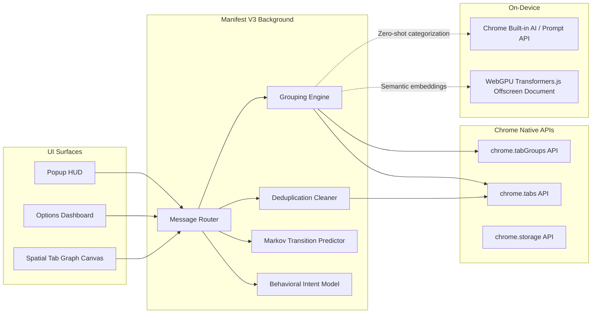

# Entab-D 🚀

[](LICENSE)
[](manifest.json)
[](https://www.google.com/chrome/)
[](CONTRIBUTING.md)

**Entab-D** is an intelligent, privacy-first Chrome extension (Manifest V3) designed to declutter browser sessions through automated rule grouping, smart deduplication, on-device Chrome Built-in AI classification, and spatial workspace knowledge mapping. Built with zero third-party telemetry.

---

## Architecture Overview



---

## Core Capabilities

- **Deterministic & AI Hybrid Tab Grouping**: Groups tabs via user keyword rules or autonomously via Chrome Built-in AI (Gemini Nano) and WebGPU dense vector embeddings.
- **Smart & Semantic Deduplication**: Eliminates identical URLs (stripping tracking parameters) and identifies cross-URL semantic duplicates.
- **User Intent & Workflow Recognition**: Detects cognitive browsing modes (*Debugging*, *Deep Research*, *Reading*) and tunes tab switching recommendations.
- **Spatial Tab Knowledge Graph**: Interactive 2D visual canvas showing how tabs spawn, link, and relate semantically.
- **Multi-Tab Research Synthesizer**: Map-reduce summarizer transforming 10+ research tabs into an actionable Markdown briefing.
- **Tab Discarding & Memory Saver**: Automatically hibernates inactive or collapsed tab groups to reclaim workstation RAM.

---

## Quick Start

### Installation (Unpacked Developer Mode)

1. Clone this repository:
   ```bash
   git clone https://github.com/Inkesk-Dozing/entab-D.git
   cd entab-D
   ```
2. Open Google Chrome and navigate to `chrome://extensions`.
3. Enable **Developer mode** using the toggle switch in the top-right corner.
4. Click **Load unpacked** and select the repository directory.
5. Pin **Entab-D** to your toolbar for immediate access.

### (Optional) Local Python Sync Daemon

If you wish to run the local backup server:
```bash
cd python
pip install -r requirements.txt
python app.py
```

---

## Documentation Architecture

Technical specifications and architectural plans are maintained in [`/docs`](docs/):

- **Architecture (`docs/architecture/`)**:
  - [System Architecture](docs/architecture/system-architecture.md)
  - [Service Worker Lifecycle](docs/architecture/service-worker-lifecycle.md)
  - [Tab Grouping Engine](docs/architecture/tab-grouping-engine.md)
- **API References (`docs/api/`)**:
  - [Extension Internal Messaging API](docs/api/extension-messaging-api.md)
  - [Local Sync Daemon API Spec](docs/api/backend-sync-spec.md)
- **Component Specifications (`docs/components/`)**:
  - [Background Service Worker](docs/components/background-service-worker.md)
  - [Tab Grouper Engine](docs/components/tab-grouper.md)
  - [Duplicate Detector](docs/components/duplicate-detector.md)
  - [Predictive Engine](docs/components/predictive-engine.md)
  - [Popup Interface (HUD)](docs/components/popup-ui.md)
  - [Options Rule Manager](docs/components/options-rule-manager.md)
- **Security (`docs/security/`)**:
  - [Threat Modeling & Mitigation](docs/security/threat-model.md)
  - [Permissions & CSP Policy](docs/security/permissions-and-csp.md)
- **Strategic Roadmap**:
  - [Complete Development Roadmap (MVP 1 & MVP 2)](docs/roadmap.md)

---

## Production Issue Specifications (`docs/issues/`)

### Part I: MVP 1 — Hardened Deterministic Foundation
- [Issue 001: Manifest Module Resolution & Missing Assets](docs/issues/001-fix-manifest-module-resolution-and-missing-assets.md)
- [Issue 002: Service Worker Lifecycle & State Persistence](docs/issues/002-fix-service-worker-lifecycle-and-state-persistence.md)
- [Issue 003: Dynamic Tab Re-evaluation on Rule Updates](docs/issues/003-fix-dynamic-tab-reevaluation-on-rule-updates.md)
- [Issue 004: Race Condition in Duplicate Tab Removal](docs/issues/004-fix-race-condition-in-duplicate-detection-and-removal.md)
- [Issue 005: Cross-Window Tab Group Consolidation](docs/issues/005-feat-cross-window-tab-group-consolidation.md)
- [Issue 006: Rule Conflict Detection & Priority Ordering](docs/issues/006-feat-rule-conflict-detection-and-priority-resolution.md)
- [Issue 007: Bounded Markov Predictive Tab Switching](docs/issues/007-feat-markov-chain-predictive-tab-switching.md)
- [Issue 008: Local Sync Daemon Security & CORS Mitigation](docs/issues/008-sec-secure-local-sync-daemon-and-cors-mitigation.md)
- [Issue 009: Batch Tab Operations & API Throttling](docs/issues/009-perf-batch-tab-query-and-tabgroups-api-throttling.md)
- [Issue 010: Dark Mode & Accessible Tab Interface](docs/issues/010-ui-dark-mode-and-accessible-tab-management-interface.md)
- [Issue 011: Advanced Subdomain Wildcards & Path Matching](docs/issues/011-feat-domain-hierarchy-and-subdomain-wildcard-matching.md)
- [Issue 012: Automated Playwright E2E Test Suite](docs/issues/012-test-end-to-end-playwright-extension-test-suite.md)
- [Issue 013: Tab Discarding & Memory Saver Integration](docs/issues/013-perf-chrome-tab-discarding-and-memory-saver-integration.md)
- [Issue 014: Pinned & Audible Tab Exclusion Policies](docs/issues/014-feat-pinned-tab-and-audible-tab-exclusion-policies.md)
- [Issue 015: Storage Quota Guard & Sync Chunking](docs/issues/015-perf-storage-quota-guard-and-sync-chunking.md)
- [Issue 016: Keyboard-Driven Fuzzy Tab Switcher HUD](docs/issues/016-feat-keyboard-driven-fuzzy-tab-switcher-hud.md)
- [Issue 017: Context Menus for Quick Rule Creation](docs/issues/017-ui-context-menu-actions-for-quick-rule-creation.md)
- [Issue 018: Encrypted Backup Export & Import](docs/issues/018-sec-end-to-end-encrypted-backup-export-and-import.md)
- [Issue 019: Tab Productivity Visualizer & Analytics](docs/issues/019-ui-tab-analytics-dashboard-and-productivity-visualizer.md)
- [Issue 020: Automated Chrome Web Store Packaging Pipeline](docs/issues/020-chore-automated-chrome-web-store-packaging-and-release-pipeline.md)

### Part II: MVP 2 — Cognitive AI Workspace Layer
- [Issue 021: On-Device Tab Classification via Chrome Built-in AI (Prompt API / Gemini Nano)](docs/issues/021-feat-chrome-built-in-ai-prompt-api-integration.md)
- [Issue 022: WebGPU Local Embeddings & Semantic Unsupervised Tab Clustering](docs/issues/022-feat-local-embeddings-and-semantic-tab-clustering.md)
- [Issue 023: Generative Group Labeling & Contextual Title Auto-Generation](docs/issues/023-feat-smart-auto-naming-of-unlabeled-tab-groups.md)
- [Issue 024: Real-Time User Intent Recognition and Predictive Tab Flow Engine](docs/issues/024-feat-user-intent-and-workflow-state-recognition.md)
- [Issue 025: Interactive Tab Knowledge Graph & Spatial Relationship Mapping](docs/issues/025-feat-semantic-tab-graph-and-spatial-workspace-mapping.md)
- [Issue 026: Generative Tab Group Digest and Multi-Tab Research Synthesizer](docs/issues/026-feat-ai-smart-tab-summarizer-and-digest-generator.md)
- [Issue 027: Context-Aware Workspace Auto-Switching & Time-of-Day Profiles](docs/issues/027-feat-context-aware-workspace-auto-switching.md)
- [Issue 028: Semantic Duplicate Detection (Cross-URL Content Equivalence)](docs/issues/028-feat-duplicate-tab-semantic-equivalence-detection.md)
- [Issue 029: Intelligent Tab Triage & "Inbox Zero" Workspace Archival Assistant](docs/issues/029-feat-smart-tab-triage-and-inbox-zero-auto-archive.md)
- [Issue 030: Local On-Device Preference Refinement & Federated Learning Guard](docs/issues/030-feat-privacy-preserving-federated-model-fine-tuning.md)

---

## Governance & Contributing

- [Contributing Guidelines](CONTRIBUTING.md)
- [Security Policy](SECURITY.md)
- [Apache 2.0 License](LICENSE)
