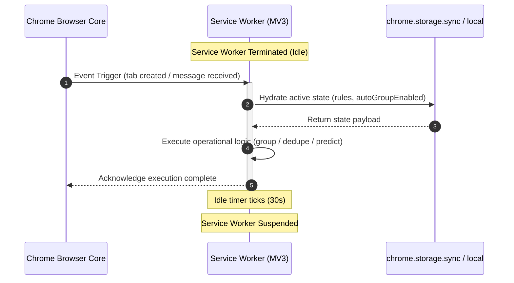

# Service Worker Lifecycle & State Resiliency

Under Chrome Manifest V3, background pages are replaced by transient service workers. Service workers terminate after approximately 30 seconds of inactivity and re-instantiate on native browser events or runtime messages. In-memory variables are destroyed on suspension, necessitating strict persistence contracts.

## Critical Lifecycle Constraints

1. **State Destruction**: Global variables (such as `let autoGroupEnabled = false;`) cannot be relied upon across event triggers. State must always be read from `chrome.storage` during initialization or cached with immediate fallback hydration.
2. **Asynchronous Listeners**: Event listeners (e.g., `chrome.tabs.onCreated`, `chrome.runtime.onMessage`) must be registered synchronously at top-level script evaluation, never inside asynchronous callbacks.
3. **Module Resolution**: When ES module syntax (`import`/`export`) is employed, `manifest.json` must declare `"type": "module"` under the `"background"` stanza; otherwise, script evaluation throws fatal execution exceptions before listeners bind.
