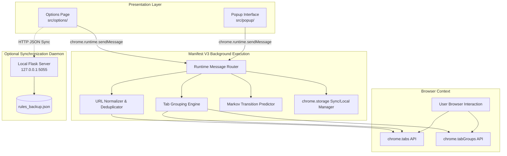

# System Architecture

Entab-D operates as a modular, privacy-preserving Chrome Extension built on the Manifest V3 architecture. The system orchestrates tab state directly through the Chrome Extensions APIs, maintaining high responsiveness and zero third-party telemetry.

## Architectural Layers

### 1. Presentation Layer
- **Popup (`src/popup/`)**: Compact HUD launched from the extension action badge. Enables one-click tab grouping, duplicate scanning, duplicate destruction, auto-group toggle, and immediate switching to predictively recommended tabs.
- **Options (`src/options/`)**: Dedicated full-page management dashboard. Allows configuring custom rules (group names, colors, keyword matching lists), adjusting predictive settings, and exporting/importing rule configurations.

### 2. Service Worker Core
- Operates under the transient Manifest V3 lifecycle. Handles inbound runtime messaging from UI surfaces, listens for native Chrome tab events (`onCreated`, `onUpdated`, `onActivated`, `onRemoved`), and executes stateful grouping transformations.
- Communicates asynchronously with `chrome.storage.sync` (user settings and rules) and `chrome.storage.local` (predictive Markov transition tables).

### 3. Native Chrome APIs
- **`chrome.tabs`**: Queries tab metadata, normalizes URLs, moves tabs within/across window indexes, and terminates duplicate instances.
- **`chrome.tabGroups`**: Dynamically creates, titles, colors, and collapses tab groupings.
- **`chrome.storage`**: Ensures cross-device configuration synchronization without requiring external database logins.

### 4. Optional Local Daemon
- Standalone Python service running on `127.0.0.1:5055` providing desktop-level backup and programmatic rule configuration for developer automation.
