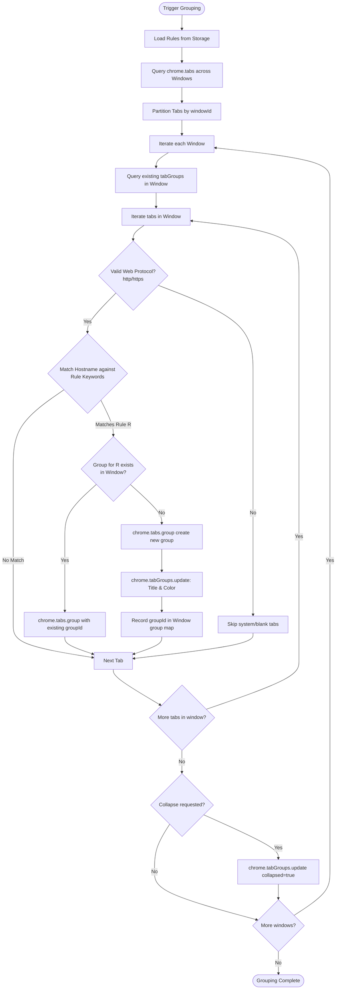

# Tab Grouping Engine Specification

The grouping engine evaluates open browser tabs against user-defined rule matrices to assign them into titled, color-coded Chrome tab groups.

## Window Isolation Constraint

Chrome enforces strict window boundaries for tab groups: **a tab group ID is valid only within the window where it was created**. Attempting to move a tab from Window A into a Group ID belonging to Window B throws runtime exceptions (`chrome.tabs.group: Group belongs to another window`). The engine must partition tab processing by `windowId` and index group IDs independently per window.
