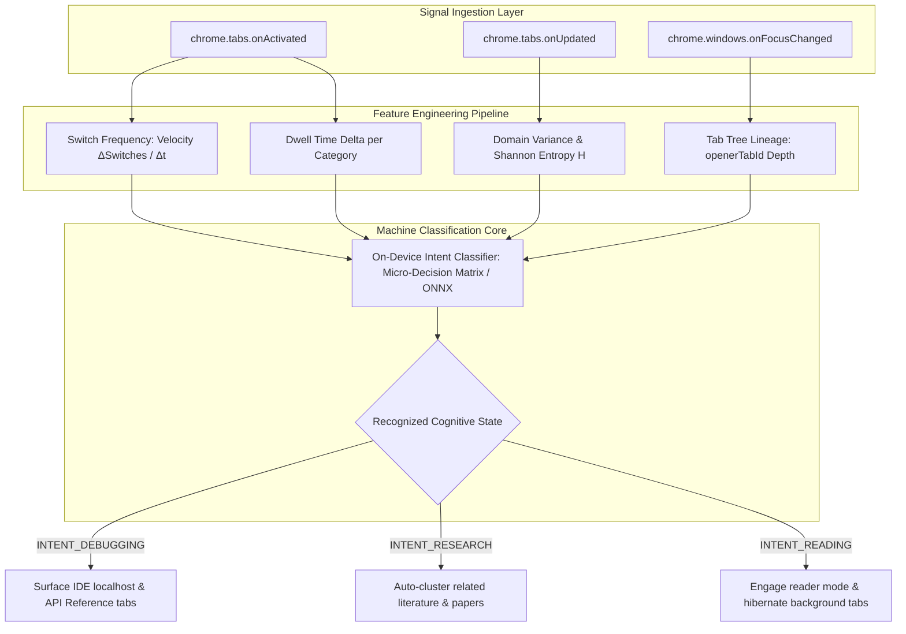

# [ARCH-SPEC] Automated User Intent Recognition, Machine Learning Tab Flow Modeling, and High-Performance Session Persistence

**Status**: In Progress  
**Target Milestone**: MVP 2 (Cognitive AI Layer)  
**Labels**: `enhancement`, `chrome-extension`, `machine-learning`, `architecture`

---

## 1. Executive Summary & Vision
Current tab management extensions treat tabs as disconnected, static URL pointers. Users, however, interact with the browser in fluid **cognitive workflows**—switching rapidly between development servers and documentation during debugging, branching deeply into cited sources during research, or linearly consuming long-form content.

This initiative establishes the foundational intelligence layer for **Entab-D**:
1. **Real-time User Intent Modeling**: Infers the user's active cognitive operational mode (*Debugging/Problem-Solving*, *Deep Research*, *Communication*, *Linear Consumption*) directly from browser interaction heuristics.
2. **High-Performance Tab State Store**: Overhauls storage architecture with indexed transition tables, bounded memory footprints, and atomic persistence routines to eliminate quota bottlenecks.
3. **Machine Logic & Predictive Routing**: Processes normalized behavioral event streams through time-decayed transition graphs and local on-device machine learning models to recommend tab destinations with sub-millisecond latency.

---

## 2. Core Architectural Pillars

### Pillar A: Intent Feature Extraction & Cognitive State Inference
The background service worker intercepts native browser events (`chrome.tabs.onActivated`, `chrome.tabs.onUpdated`, `chrome.windows.onFocusChanged`) and feeds a rolling 15-minute sliding window into a lightweight feature extractor.



#### Behavioral Metric Formulations
- **Switch Velocity ($V_s$)**: Measures the rate of active tab swaps:
  $$V_s = \frac{N_{\text{switches}}}{\Delta t_{\text{window}}}$$
- **Domain Entropy ($H$)**: Quantifies whether attention is concentrated on a single cluster or scattered across diverse domains:
  $$H = -\sum_{i=1}^{K} p_i \log_2(p_i)$$
  *(High entropy indicates multi-domain comparative research; low entropy indicates deep focus on a single task).*

---

### Pillar B: Storage Optimization & Normalized Data Structures
To resolve quota limits and performance stalls during high tab counts:
- **Indexed Transition Maps**: Tab navigation transitions are stored as normalized pair tuples `(fromHash, toHash)` with compact 64-bit integer hashes instead of raw URL strings.
- **Least-Recently-Used (LRU) Pruning**: Enforces a strict capacity ceiling (maximum 300 active nodes) to guarantee compliance with Chrome storage quotas.
- **Atomic Double-Buffered Writes**: Debounces persistence calls by 500ms to consolidate burst writes during rapid tab creation or restoration.

```typescript
interface TabBehaviorRecord {
  sourceHash: number;      // FNV-1a hash of normalized origin URL
  targetHash: number;      // FNV-1a hash of destination URL
  transitionWeight: number;// Exponentially decayed frequency count
  lastTraversed: number;   // Epoch timestamp (ms)
}
```

---

### Pillar C: Predictive Recommendation & Tab Routing
When the user opens the popup HUD or activates the quick-switcher shortcut (`Alt + Q`):
1. The engine queries current tab context `(tab.id, tab.url, activeIntent)`.
2. Queries the transition matrix for destination nodes with the highest cumulative transition weight $W(S \rightarrow T)$.
3. Filters matching candidates against open tabs in memory.
4. Renders the top candidate in the popup HUD:
   ```text
   🔄 Switch to: React Documentation (94% confidence match) [Press Enter]
   ```

---

## 3. Implementation Roadmap & Technical Deliverables

- [ ] **Phase 1: Telemetry & Event Ingestion**
  - Implement non-blocking event dispatchers in `src/background/service_worker.js`.
  - Filter out internal system schemes (`chrome://`, `devtools://`, `about:blank`).
- [ ] **Phase 2: Intent Engine & Metric Pipeline**
  - Construct `src/behavior/intent_tracker.js` calculating rolling entropy, switch velocity, and dwell time.
  - Implement heuristic state classifier outputting cognitive modes.
- [ ] **Phase 3: Storage Schema Overhaul**
  - Build `src/storage/transition_store.js` with LRU eviction and memory bounds.
  - Migrate raw URL strings to compact hashed identifiers.
- [ ] **Phase 4: UI Surfacing & Hotkey Integration**
  - Render active cognitive intent badge in `src/popup/popup.html`.
  - Add instant tab switch recommendations with one-click and hotkey activation.

---

## 4. Acceptance Criteria & Quality Gates

1. **Accuracy**: The intent engine distinguishes between rapid debugging cycles and sustained long-form reading within 90 seconds of browsing activity.
2. **Performance**: Feature extraction and transition recording execute in under **2 milliseconds** per tab switch; background CPU utilization remains strictly `< 0.2%`.
3. **Storage Safety**: Memory consumption in `chrome.storage.local` remains strictly bounded below **500 KB** regardless of how many tabs or days the user navigates.
4. **Privacy**: All tracking, feature computation, and model scoring execute **100% locally on-device**; zero telemetry or URL data is ever transmitted externally.
