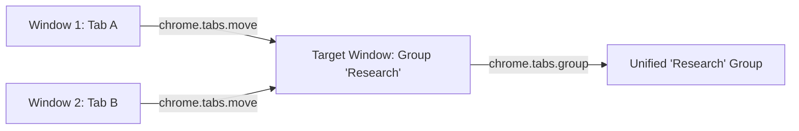

# Issue 005: [FEAT] Cross-Window Tab Group Consolidation and Workspace Unification

**Labels**: `enhancement`, `tab-groups`, `roadmap`

---

## 1. Context & Problem Statement
Currently, `groupTabsByRules()` operates strictly per-window:
```javascript
for (const [windowId, wtabs] of byWindow.entries()) { ... }
```
If a user has 3 browser windows open, running the grouper creates 3 disconnected "Study" groups (one per window). This fragments the user's workspace rather than organizing it.

Users need an optional workflow to consolidate tabs of the same category across all open windows into a single master group hosted in a designated target window.

---

## 2. Technical Challenges & Architectural Design
Chrome's `chrome.tabGroups` API strictly prohibits moving tabs into groups belonging to another window directly. To consolidate:
1. The target window must be elected (e.g. current focused window, or the window containing the most tabs matching that group).
2. Tabs residing in external windows must first be transferred using `chrome.tabs.move(tabId, { windowId: targetWindowId, index: -1 })`.
3. Once transferred to the target window, the tabs can be assigned to the consolidated `groupId` using `chrome.tabs.group()`.



---

## 3. Implementation Plan
- [ ] Add configuration flag in `options.html`: `consolidateAcrossWindows: boolean` (default: `false` to preserve existing workflows).
- [ ] Implement window election algorithm:
  - Default: Primary focused window (`chrome.windows.WINDOW_ID_CURRENT`).
  - Fallback: Window with the maximum tab count for that specific category.
- [ ] Implement batch migration pipeline:
  ```javascript
  async function consolidateGroupsAcrossWindows(targetWindowId) { ... }
  ```
- [ ] Guard against pinned tabs and full-screen application windows.

---

## 4. Acceptance Criteria
1. When consolidation is enabled, all tabs matching a rule across all windows are gathered into one window and grouped together.
2. Pinned tabs remain in their respective original windows and are not forcibly moved.
3. If an external window becomes completely empty after tabs are migrated, it closes cleanly without crashing the Chrome session.
