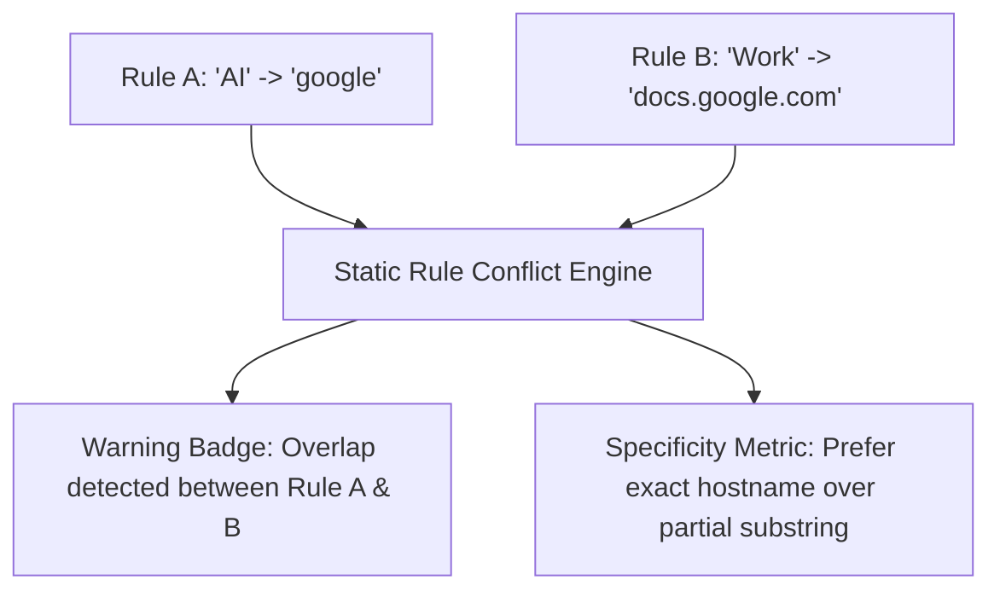

# Issue 006: [FEAT] Rule Conflict Detection, Overlap Highlighting, and Priority Ordering

**Labels**: `enhancement`, `ui/ux`, `tab-groups`

---

## 1. Context & Problem Statement
Currently, rule matching follows a first-match-wins strategy:
```javascript
for (const r of rules) {
  const hit = r.keywords.some(k => host.includes(k.toLowerCase()));
  if (hit) { matchedRule = r; break; }
}
```
If a user creates Rule 1 ("AI", keyword: `"deepseek"`) and Rule 2 ("Research", keyword: `"deepseek.com"`), or broad keywords like `"google"` and specific keywords like `"docs.google"`, the behavior is non-deterministic depending solely on UI array order.

There is currently no visual indicator warning the user that their rules overlap, leading to confusion when tabs end up in unexpected groups.

---

## 2. Technical Design



### Specificity Scoring Metric
Calculate keyword specificity score:
- Exact hostname match (`docs.google.com`) = Weight 100
- Domain root match (`google.com`) = Weight 50
- Generic substring match (`google`) = Weight 10
Higher specificity score takes precedence over earlier array position.

---

## 3. Implementation Plan
- [ ] Implement conflict detection analysis in `options.js`:
  - Cross-compare keyword tokens pairwise across rules.
  - Highlight colliding rule cards with amber warning badges and tooltip explanations.
- [ ] Add drag-and-drop rule reordering in `options.html` allowing users to explicitly prioritize rule evaluation order.
- [ ] Upgrade `service_worker.js` matcher to evaluate specificity weight before falling back to array index.

---

## 4. Acceptance Criteria
1. The Options page visually flags conflicting or overlapping keywords across rule definitions.
2. Users can drag and reorder rules to dictate explicit priority.
3. More specific keywords (e.g. `mail.google.com`) reliably win over broader keywords (`google.com`).
