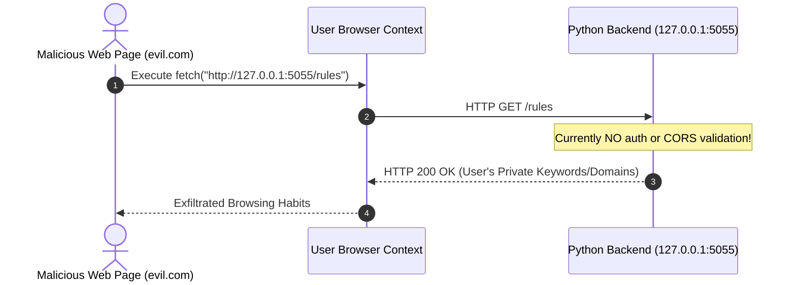

# Issue 008: [SEC] Local Sync Daemon Security Hardening, Token Authentication, and CORS Restriction

**Labels**: `security`, `backend`, `python`

---

## 1. Context & Problem Statement
The local Python backup daemon (`python/app.py`) listens on `http://127.0.0.1:5055` with zero authentication:
```python
@app.route("/rules", methods=["POST"])
def set_rules():
    data = request.get_json(silent=True) or {}
    ...
```
Any malicious website running inside the user's browser (or any unauthorized process on the workstation) can make cross-origin fetch requests to `http://127.0.0.1:5055/rules`. A web page could:
1. Exfiltrate the user's private domain rules, keywords, and study/work patterns (`GET /rules`).
2. Overwrite the user's rules with malicious or corrupted payloads (`POST /rules`).

---

## 2. Threat Modeling & Attack Scenario



---

## 3. Implementation Plan
- [ ] Implement Token Authentication:
  - Generate a secure random token (`secrets.token_hex(32)`) saved to `.env` or local daemon config.
  - Require HTTP Header: `X-Entab-Token: <token>` on all mutation and retrieval endpoints.
  - Reject requests without valid token with `401 Unauthorized`.
- [ ] Implement Strict CORS Whitelisting:
  - Restrict `Access-Control-Allow-Origin` strictly to the extension's origin (`chrome-extension://<EXTENSION_ID>`).
  - Reject requests from arbitrary web origins (`evil.com`).
- [ ] Add rate limiting using Flask-Limiter (max 30 requests/minute).

---

## 4. Acceptance Criteria
1. Requests originating from external web domains (e.g. `evil.com`) are rejected via CORS policy.
2. Direct HTTP requests without the `X-Entab-Token` header fail with `401 Unauthorized`.
3. The extension Options page stores the shared token securely in `chrome.storage.local` and seamlessly authenticates sync requests.
