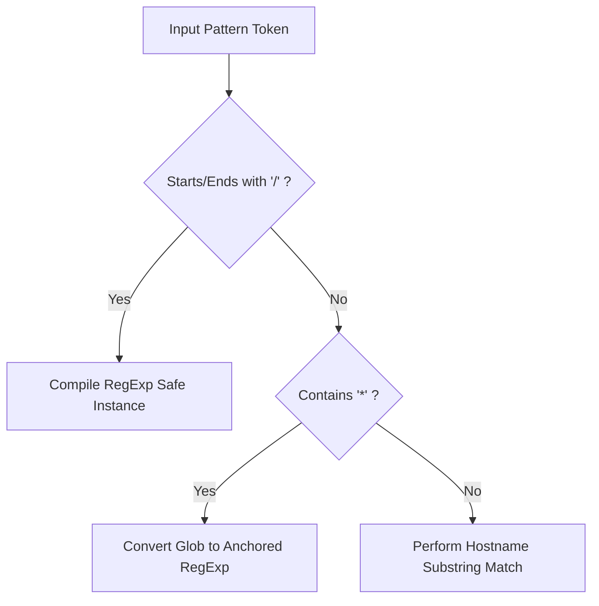

# Issue 011: [FEAT] Advanced URL Matching with Subdomain Wildcards and Path RegEx Support

**Labels**: `enhancement`, `tab-groups`, `roadmap`

---

## 1. Context & Problem Statement
Currently, rule matching uses naive case-insensitive substring search:
```javascript
const hit = r.keywords.some(k => host.includes(k.toLowerCase()));
```
This naive search causes false positives and cannot express nuanced matching logic:
- A keyword `"mail"` matches `gmail.com`, `dailymail.co.uk`, and `blackmail.com`.
- Users cannot match specific subdomains (e.g. `docs.*` or `staging-*.acme.corp`).
- Users cannot scope rules to specific URL paths (e.g. `github.com/eOzkull/*` into "Work", but `github.com/trending` into "General").

---

## 2. Technical Architecture & Match Grammar

Upgrade keyword tokens to support three distinct matching formats:
1. **Plain Domain/Keyword**: Exact host or subdomain contains match (legacy compatible).
2. **Glob / Wildcard Pattern**: Prefixed with `*` (e.g. `*.aws.amazon.com`, `docs.*.org`).
3. **RegEx / Path Pattern**: Enclosed within forward slashes (e.g. `/github\.com\/eOzkull\/.*/i`).



---

## 3. Implementation Plan
- [ ] Implement a safe pattern compilation utility with ReDoS prevention (reject nested quantifiers).
- [ ] Cache compiled regular expressions in memory for the duration of the grouping pass to avoid recompilation overhead.
- [ ] Update `options.html` with syntax helper tooltips and real-time test preview: users type a test URL to immediately verify which rule claims it.

---

## 4. Acceptance Criteria
1. Wildcard patterns like `*.google.com` match `mail.google.com` and `drive.google.com`, but do not match `notgoogle.com`.
2. Path patterns like `/github\.com\/repo\/.*/` group only tabs matching specific repository URLs.
3. Invalid regular expressions entered by users are highlighted in red in the UI without crashing the background service worker.
