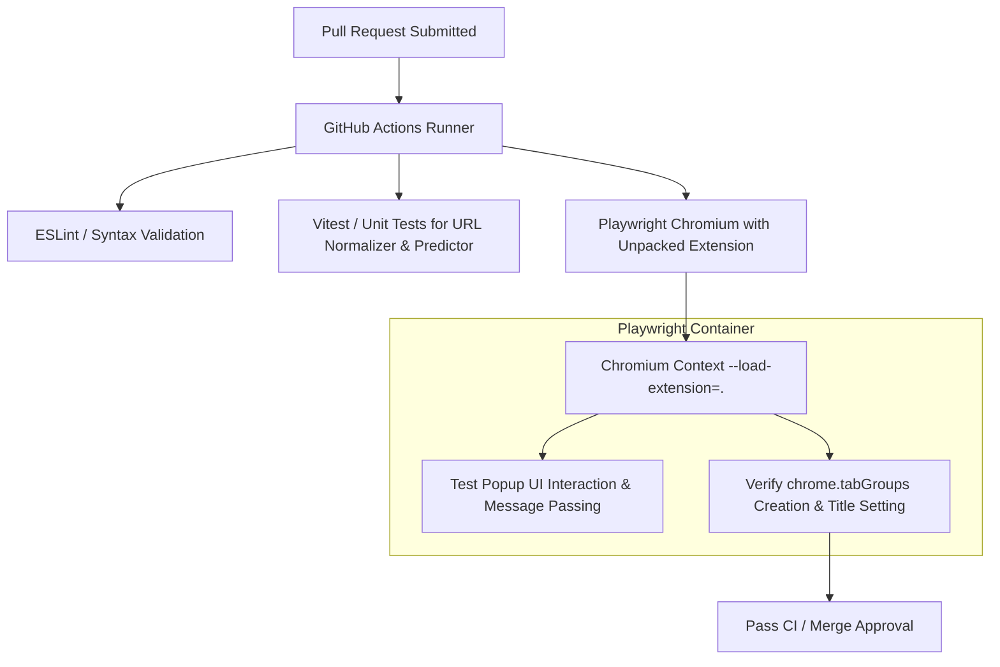

# Issue 012: [TEST] Automated End-to-End Test Suite Using Playwright and Mock Chrome Extensions API

**Labels**: `testing`, `ci/cd`, `automation`

---

## 1. Context & Problem Statement
The repository currently contains zero automated unit tests, integration tests, or end-to-end (E2E) browser verification scripts.
- Regressions in tab grouping or URL normalization must be caught by manually loading unpacked files in Chrome.
- Pull requests cannot be verified automatically in GitHub Actions, increasing the risk of shipping broken background scripts or manifest syntax errors.

---

## 2. Technical Design & CI Architecture

---

## 3. Implementation Plan
- [ ] Initialize testing dependencies in a root `package.json`:
  - `playwright`, `vitest`, `@types/chrome`.
- [ ] Write unit tests for:
  - `normalizeUrl()` (verifying parameter stripping: UTM, GCLID, fragments, trailing slashes).
  - `Predictor` (testing transition score accumulation, sorting, and LRU pruning).
  - `Specificity Matcher` (testing wildcard and priority resolution).
- [ ] Write Playwright E2E test launching Chromium with `--disable-extensions-except=. --load-extension=.`:
  - Open 5 mock tabs (`leetcode.com`, `coursera.org`, `arxiv.org`, duplicates).
  - Trigger `GROUP_TABS` and assert tab groups exist with expected titles and colors.
  - Trigger `CLOSE_DUPLICATES` and assert duplicate tabs are terminated.
- [ ] Create `.github/workflows/ci.yml` running tests on every PR and commit to `main`.

---

## 4. Acceptance Criteria
1. `npm test` executes all unit tests with 100% pass rate in under 5 seconds.
2. `npm run test:e2e` spins up headless Chromium, loads the extension, verifies grouping and deduplication, and exits cleanly.
3. GitHub Actions CI pipeline blocks PR merges on failing tests or lint errors.
