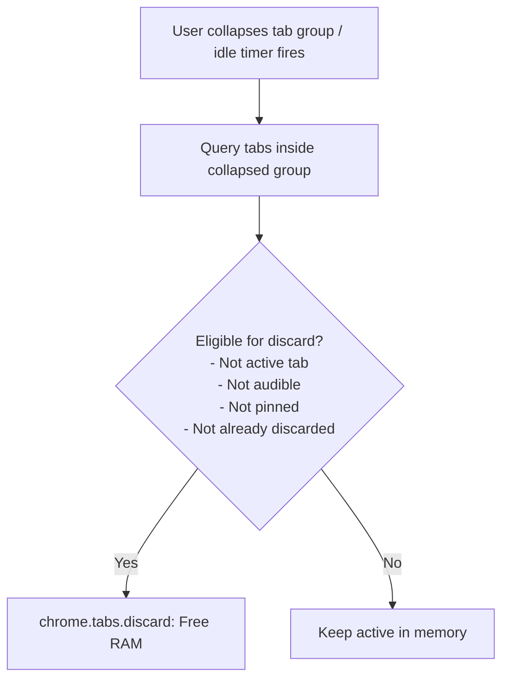

# Issue 013: [PERF] Tab Discarding & Memory Saver Integration for Inactive Tab Groups

**Labels**: `performance`, `tab-groups`, `optimization`

---

## 1. Context & Problem Statement
Power users often maintain dozens of grouped tabs (e.g. 30 "Research" tabs, 25 "Education" tabs). Even when these tab groups are collapsed, Chrome continues consuming significant RAM and CPU cycles for rendering processes, background timers, and web workers.

Chrome's native Memory Saver periodically discards tabs, but Entab-D does not provide programmatic control to immediately discard (hibernate) background tabs within inactive or collapsed groups.

---

## 2. Technical Architecture & Design
Chrome provides `chrome.tabs.discard(tabId)` which evicts the tab's web contents from RAM while preserving its title, favicon, URL, and position in the tab strip. When the user clicks the tab, Chrome seamlessly reloads it from cache.

---

## 3. Implementation Plan
- [ ] Add permission `"tabGroups"` and verify `chrome.tabs.discard` capability in Manifest V3.
- [ ] Implement `discardGroupTabs(groupId)`:
  - Query all tabs belonging to `groupId`.
  - Filter out `active === true`, `audible === true`, and `pinned === true`.
  - Dispatch `chrome.tabs.discard` with `Promise.allSettled`.
- [ ] Add toggle in Options: *"Auto-discard tabs when a group is collapsed"* and *"Auto-discard tabs inactive for > 60 minutes"*.
- [ ] Add "Hibernate Group" button directly to group context / popup menu.

---

## 4. Acceptance Criteria
1. Collapsing a group with 20 tabs immediately reclaims 500MB+ of workstation RAM.
2. Audible tabs (playing Spotify, YouTube, or Google Meet) are never discarded.
3. Clicking a discarded tab instantly restores the page state without losing group association.
