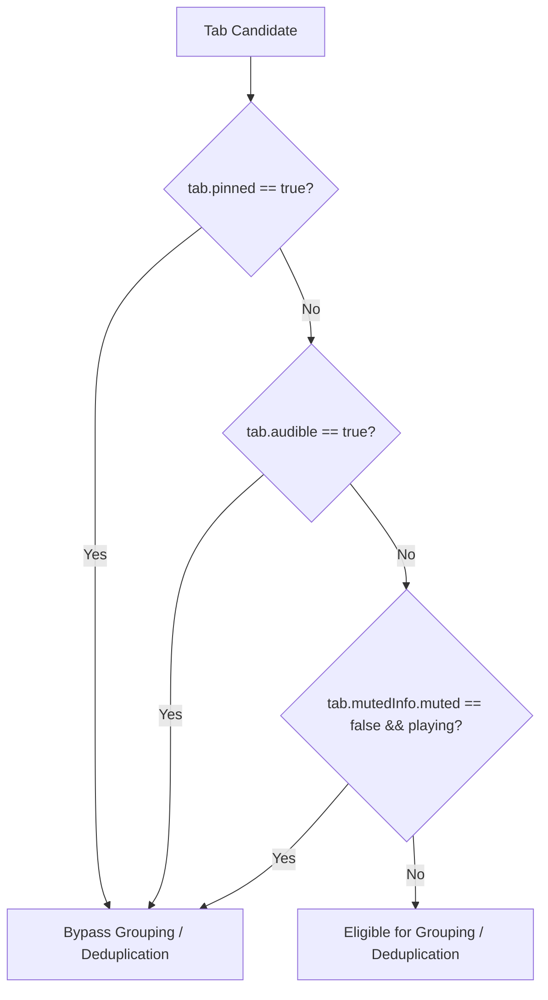

# Issue 014: [FEAT] Tab Exclusion Policies for Pinned, Audible, and Picture-in-Picture Tabs

**Labels**: `enhancement`, `reliability`, `tab-groups`

---

## 1. Context & Problem Statement
Currently, `groupTabsByRules()` and `closeDuplicates()` blindly process every tab returned by `chrome.tabs.query({})`. This introduces three severe user disruptions:
1. **Pinned Tabs**: Chrome does not permit pinned tabs to be grouped inside regular tab groups. Attempting to group a pinned tab either fails or forcibly unpins it, destroying user layout.
2. **Audio/Video Playback**: If a duplicate scanner or auto-grouper terminates or moves an active media tab (e.g., YouTube Music, podcast stream), the user's audio playback is interrupted abruptly.
3. **Picture-in-Picture (PiP) / Screen Sharing**: Tabs actively capturing video or screen sharing must not be moved across windows or closed.

---

## 2. Technical Architecture & Filter Specification



---

## 3. Implementation Plan
- [ ] Implement `isTabProtected(tab: chrome.tabs.Tab): boolean`:
  ```javascript
  function isTabProtected(tab) {
    if (tab.pinned) return true;
    if (tab.audible) return true;
    if (tab.url && tab.url.startsWith("chrome://")) return true;
    return false;
  }
  ```
- [ ] Integrate `isTabProtected()` into both `groupTabsByRules()` and `findDuplicates()`.
- [ ] Add explicit settings under Options:
  - `[x] Ignore pinned tabs` (default: ON)
  - `[x] Never close tabs playing audio` (default: ON)
  - `[ ] Ignore muted background tabs` (default: OFF)

---

## 4. Acceptance Criteria
1. Pinned tabs remain permanently untouched in the tab strip during manual and automatic grouping runs.
2. Background tabs streaming audio are never selected for duplicate termination, even if another identical tab exists.
3. Protected tabs are visually marked with a shield icon in the duplicate review HUD.
