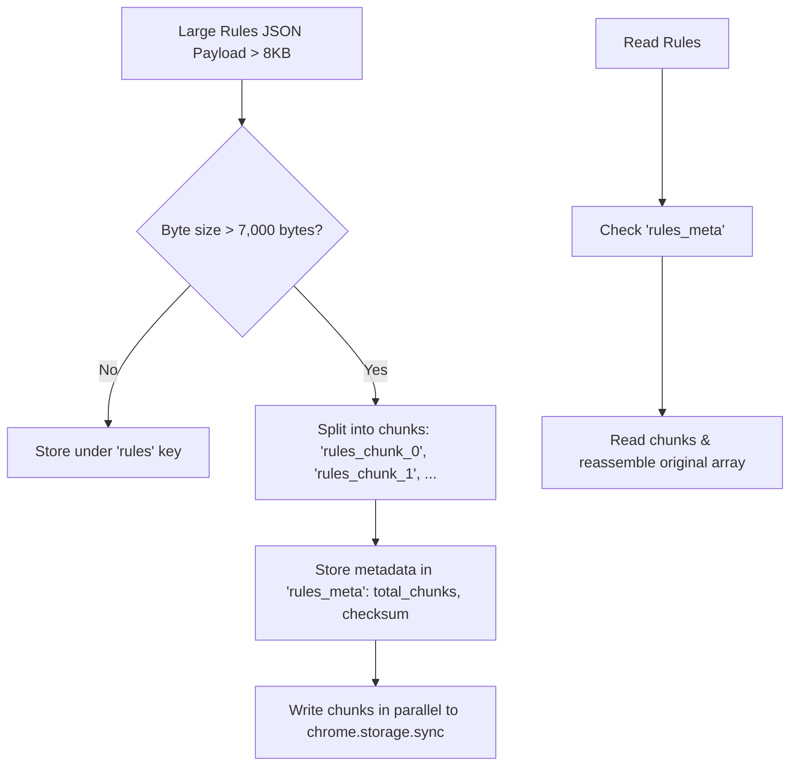

# Issue 015: [PERF] Storage Quota Guard, Data Compression, and Sync Chunking

**Labels**: `performance`, `storage`, `reliability`

---

## 1. Context & Problem Statement
Chrome's `chrome.storage.sync` enforces strict quotas:
- `QUOTA_BYTES_PER_ITEM`: Maximum **8,192 bytes** (8 KB) per key.
- `QUOTA_BYTES`: Maximum **102,400 bytes** (100 KB) total across all synced items.
- `MAX_WRITE_OPERATIONS_PER_MINUTE`: 120 writes/minute.

Currently, `SAVE_RULES` stores the entire rules array inside a single storage key:
```javascript
chrome.storage.sync.set({ rules: msg.rules });
```
When a power user defines 20+ detailed rules with long domain lists and regex patterns, the payload easily exceeds 8 KB, causing `chrome.runtime.lastError: QuotaExceededError` and permanently failing to save user configurations.

---

## 2. Technical Design & Chunking Architecture



---

## 3. Implementation Plan
- [ ] Create `StorageGuard` utility in `src/utils/storage_guard.js`:
  - Calculate byte size using `new Blob([JSON.stringify(data)]).size`.
  - Automatically chunk payloads exceeding 7,000 bytes across `rules_0`, `rules_1`, etc.
  - Implement transparent reassembly in `getRules()`.
- [ ] Add fallback to `chrome.storage.local` if total sync quota is exhausted, with a prominent user notification in the Options dashboard.
- [ ] Implement write debouncing (minimum 1-second delay between writes) to prevent hitting `MAX_WRITE_OPERATIONS_PER_MINUTE`.

---

## 4. Acceptance Criteria
1. Saving a massive rule set (50 rules, 500+ keywords, ~25KB total) succeeds without throwing `QuotaExceededError`.
2. Sync state is restored seamlessly across browser reloads.
3. If sync quota is exceeded, the extension transparently falls back to local storage and warns the user.
