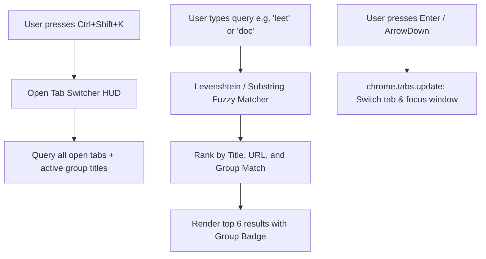

# Issue 016: [FEAT] Keyboard-Driven Quick Search & Fuzzy Tab Switcher HUD

**Labels**: `enhancement`, `ui/ux`, `keyboard-shortcuts`

---

## 1. Context & Problem Statement
Power users with 50+ open tabs distributed across 5+ groups frequently spend 10–20 seconds hunting visually across the tab strip for a specific open tab.
Currently, the extension popup only lists scanned duplicates and a few predictive suggestions. There is no instant, search-as-you-type fuzzy tab search or keyboard-activated command palette.

---

## 2. Technical Architecture & Design

Implement an integrated fuzzy tab search engine inside the popup HUD (and accessible via a standalone Chrome Command shortcut `Ctrl+Shift+K` / `Cmd+Shift+K`):

---

## 3. Implementation Plan
- [ ] Implement lightweight fuzzy search algorithm (`fuzzyScore(pattern, text)`) with zero external dependencies.
- [ ] Add search input `<input id="tabSearch" placeholder="Type to jump to any tab or group...">` at the top of `popup.html`.
- [ ] Display matching tab title, URL preview, and color-coded group badge.
- [ ] Bind keyboard shortcuts:
  - `ArrowDown` / `ArrowUp`: Navigate results.
  - `Enter`: Switch to highlighted tab and close popup.
  - `Escape`: Clear search or close popup.
- [ ] Register Chrome command `"quick_switch"` in `manifest.json`.

---

## 4. Acceptance Criteria
1. Typing "leet" immediately surfaces all LeetCode tabs across any window or group within 15ms.
2. Pressing `Enter` focuses the target tab and its parent window instantly.
3. Search input is auto-focused whenever the popup opens.
