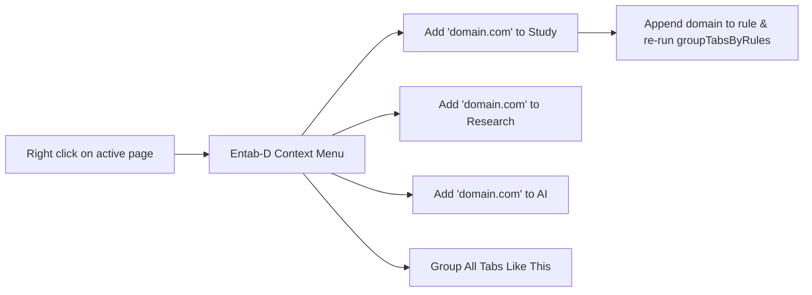

# Issue 017: [UI/UX] Chrome Context Menus for One-Click Rule Creation and On-Demand Tab Grouping

**Labels**: `ui/ux`, `enhancement`, `chrome-extension`

---

## 1. Context & Problem Statement
Adding a domain to an existing rule currently requires:
1. Navigating to the extension options page.
2. Locating the appropriate group card among all defined rules.
3. Typing or pasting the domain name into the comma-separated keywords input.
4. Clicking "Save".

This multi-step process introduces excessive friction. Users should be able to right-click on any webpage or tab and assign it directly to a category with a single click.

---

## 2. Technical Architecture & Design

Utilize `chrome.contextMenus` API to register context menus dynamically based on current user rules:

---

## 3. Implementation Plan
- [ ] Add `"contextMenus"` to `permissions` in `manifest.json`.
- [ ] Implement `updateContextMenus()` in `service_worker.js`:
  - Re-build menu items whenever `SAVE_RULES` or startup occurs.
  - Parent item: `"Entab-D"`.
  - Child items: Dynamic list of user rule names (`"Add to [RuleName]"`).
  - Utility item: `"Close all duplicate tabs"`.
- [ ] Handle `chrome.contextMenus.onClicked`:
  - Extract hostname from `info.pageUrl`.
  - Append hostname to targeted rule's keyword array.
  - Commit to `chrome.storage.sync` and notify user via Chrome notifications or badge text (`"Added!"`).

---

## 4. Acceptance Criteria
1. Right-clicking any webpage displays an "Entab-D" submenu listing all active group rules.
2. Clicking a rule immediately adds the page's domain to that rule's keyword list and moves the tab into the group.
3. Updating rule names in Options dynamically synchronizes the context menu entries.
