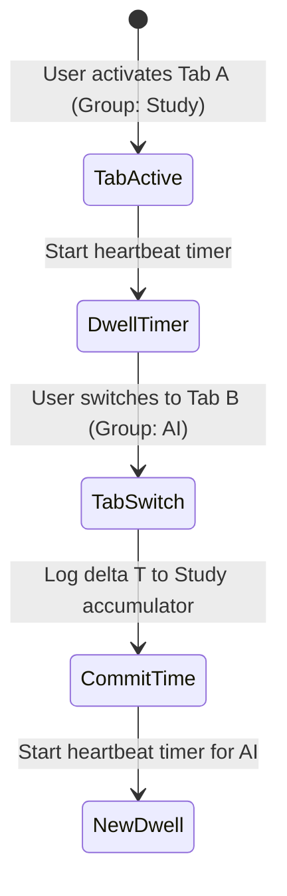

# Issue 019: [UI/UX] Tab Productivity Visualizer and Category Dwell-Time Analytics

**Labels**: `ui/ux`, `analytics`, `feature`

---

## 1. Context & Problem Statement
Users organize tabs into categories like "Study", "Research", and "AI", but have zero visibility into how their browser attention is actually divided among these groups.
Understanding time spent across tabs helps users identify productivity bottlenecks, context switching fatigue, and tab hoarding habits.

---

## 2. Technical Architecture & Design

Track active tab dwell time completely client-side in the background service worker:

### Privacy Contract
- Dwell time is tracked exclusively per **group category** (e.g. Study, Research), **never** as individual page URLs.
- Data is stored in `chrome.storage.local` and never leaves the device.

---

## 3. Implementation Plan
- [ ] Add session dwell accumulator in `service_worker.js`:
  - Listen for `chrome.tabs.onActivated` and `chrome.windows.onFocusChanged`.
  - Record elapsed active seconds per group.
- [ ] Create an Analytics tab in `options.html`:
  - CSS-based lightweight donut chart and bar graph (zero external charting libraries).
  - Displays: Daily active time per group, total tabs closed, duplicates eliminated, and most frequently used group.
- [ ] Add "Clear Analytics Data" button for complete user control.

---

## 4. Acceptance Criteria
1. Switching tabs updates dwell time for the corresponding group accurately.
2. The options analytics visualizer renders crisp daily and weekly time distributions.
3. Zero network requests are made; all metric accumulation is 100% offline and private.
