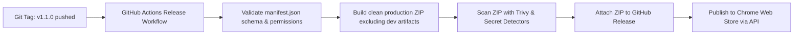

# Issue 020: [CHORE] Automated Chrome Web Store Packaging, Validation, and Release Pipeline

**Labels**: `ci/cd`, `automation`, `devops`

---

## 1. Context & Problem Statement
Currently, packaging Entab-D for distribution or Chrome Web Store publishing is manual. Manual packaging risks:
- Forgetting to increment `version` in `manifest.json`.
- Accidental inclusion of temporary files, `.git/`, test scripts, or `.env` files in the distributed ZIP archive.
- Shipping a build that fails Google Chrome Web Store automated linter and security checks.

---

## 2. Technical Architecture & CI Pipeline

---

## 3. Implementation Plan
- [ ] Create a Node.js packaging script `scripts/package-extension.js`:
  - Validates `manifest.json` version against `package.json`.
  - Verifies presence of all required icon sizes (16, 32, 48, 128).
  - Bundles strictly required runtime assets into `dist/entab-D-vX.Y.Z.zip`.
  - Excludes `.git`, `.env*`, `docs/`, `python/`, `tests/`, and scratch files.
- [ ] Create `.github/workflows/release.yml`:
  - Triggers on GitHub tag creation `v*`.
  - Builds production ZIP.
  - Automatically creates GitHub Release with auto-generated release notes.
  - Uploads ZIP to Chrome Web Store using `chrome-webstore-upload-cli` action.

---

## 4. Acceptance Criteria
1. Running `npm run package` generates a clean, minimal ZIP archive containing only runtime extension files.
2. The packaged ZIP passes `web-ext lint` or Chrome Web Store validation with zero errors.
3. Production releases are triggered automatically when git tags are created.
