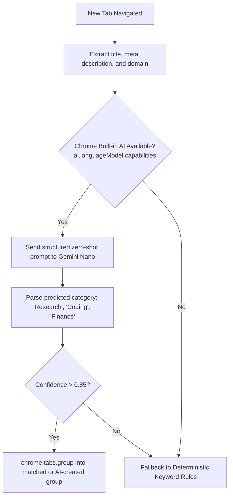

# Issue 021: [AI-FEAT] On-Device Tab Classification via Chrome Built-in AI (Prompt API / Gemini Nano)

**Labels**: `ai`, `chrome-built-in-ai`, `manifest-v3`, `roadmap-v2`

---

## 1. Context & Problem Statement
MVP 1 relies on user-defined keyword matching (e.g. `leetcode` -> "Study"). This requires manual configuration for every single site and fails completely on novel, obscure, or multi-topic domains (e.g., an arXiv paper about economics versus an arXiv paper about computer vision).

Chrome now ships with native, on-device AI capabilities via the **Chrome Built-in AI / Prompt API** (`window.ai` / `ai.languageModel` utilizing Gemini Nano). We can classify tabs locally on the user's GPU/NPU with **zero latency, zero cloud API fees, and 100% privacy preservation**.

---

## 2. Technical Architecture & Inference Pipeline



### Prompt Specification
```text
You are an operating system tab manager. Classify the following web page into exactly one category from: [Study, Research, Development, Entertainment, Finance, Social, Shopping, Other].
Title: "${tab.title}"
URL: "${tab.url}"
Meta Description: "${metaDescription}"
Respond with JSON: {"category": "...", "confidence": 0.0-1.0}
```

---

## 3. Implementation Plan
- [ ] Check `ai.languageModel.capabilities()` availability in `service_worker.js`.
- [ ] Create `src/ai/nano_classifier.js` implementing session pooling and structured JSON schema enforcement.
- [ ] Extract page metadata (`document.title`, `<meta name="description">`) via lightweight content script injection or tab capture.
- [ ] Implement caching layer in `chrome.storage.local` mapping `hostname + pathname` -> classified category to avoid re-prompting identical domains.
- [ ] Add user toggle in Options: *"Enable On-Device Gemini Nano AI Classification"*.

---

## 4. Acceptance Criteria
1. Uncategorized tabs (e.g. `https://distill.pub/2021/understanding-gnn/`) are automatically recognized and routed into "Research" without manual keyword configuration.
2. Inference executes entirely on-device; zero outbound HTTP calls to third-party AI endpoints.
3. If Chrome Built-in AI is disabled or unsupported on the user's hardware, the system degrades gracefully to standard keyword matching.
