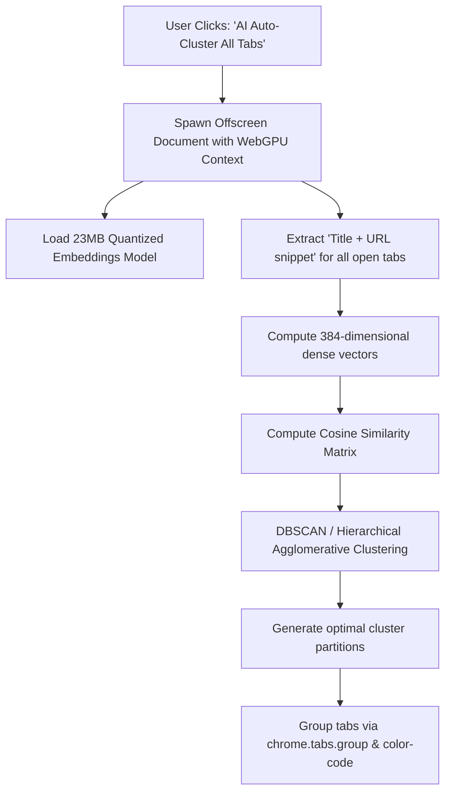

# Issue 022: [AI-FEAT] WebGPU Local Embeddings & Semantic Unsupervised Tab Clustering

**Labels**: `ai`, `webgpu`, `clustering`, `roadmap-v2`

---

## 1. Context & Problem Statement
Users frequently open 30+ tabs across completely distinct research threads (e.g. 10 tabs on "Kubernetes Helm charts", 10 tabs on "PostgreSQL replication lag", 10 tabs on "Apartment hunting in Berlin").
Predefined rules cannot anticipate dynamic user research topics. The extension must autonomously cluster open tabs by **semantic similarity**—discovering topic groups dynamically without any manual rules.

---

## 2. Technical Architecture & Vector Pipeline

Run an on-device quantized embedding model (e.g., `all-MiniLM-L6-v2` quantized via Transformers.js / ONNX Runtime Web using WebGPU acceleration) in an offscreen document:

---

## 3. Implementation Plan
- [ ] Implement Chrome Manifest V3 Offscreen Document (`chrome.offscreen.createDocument`) to execute WebGPU workloads outside the service worker.
- [ ] Integrate `@xenova/transformers` with `all-MiniLM-L6-v2` (quantized 8-bit, 23MB cached locally in CacheStorage).
- [ ] Implement Agglomerative Hierarchical Clustering algorithm in JavaScript with dynamic distance threshold $\epsilon = 0.65$.
- [ ] Route discovered clusters back to the service worker to invoke `chrome.tabs.group` and auto-assign distinct colors.

---

## 4. Acceptance Criteria
1. Clicking "AI Auto-Cluster" partitions 40 diverse tabs into 3–5 cohesive topic clusters in under 1.5 seconds on modern hardware.
2. Tabs covering the same topic from completely different domains (e.g., StackOverflow, Medium, GitHub, official docs) are grouped together into the same cluster.
3. Completely private: model weights and vector computations reside solely on the client machine.
