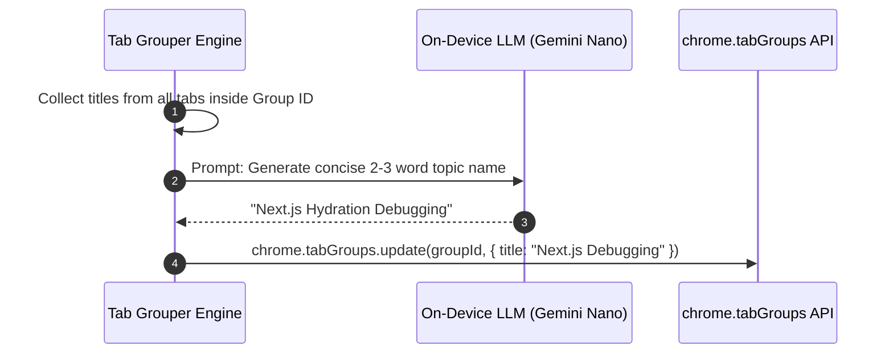

# Issue 023: [AI-FEAT] Generative Group Labeling & Contextual Title Auto-Generation

**Labels**: `ai`, `chrome-built-in-ai`, `tab-groups`, `roadmap-v2`

---

## 1. Context & Problem Statement
When tabs are clustered semantically or manually grouped by the user, Chrome tab groups default to generic titles like "Group 1" or blank headers.
Naming groups manually forces high cognitive load on the user. The AI engine should automatically inspect the collective contents of all tabs in a group and generate a punchy, 2-to-3 word contextual title (e.g. *"Next.js SSR Fixes"*, *"Tokyo Travel Flights"*, *"Q3 Earnings Reports"*).

---

## 2. Technical Architecture & Prompt Engineering



### Prompt Specification
```text
Task: Given the following list of web page titles grouped together, produce a succinct 2-to-3 word descriptive title for this browser tab group. Do not use generic words like "Websites", "Tabs", or "Group".
Page Titles:
1. "Hydration failed because the initial UI does not match - React"
2. "Next.js 14 SSR hydration mismatch with styled-components - Stack Overflow"
3. "Fixing React Hydration Errors in Next.js App Router"

Group Name (2-3 words):
```

---

## 3. Implementation Plan
- [ ] Implement `generateGroupName(tabTitles: string[]): Promise<string>` using Chrome Built-in AI (`ai.languageModel`).
- [ ] Add rule generation heuristic: if AI generates a title, offer a 1-click prompt: *"Add rule for this category?"*.
- [ ] Add emoji badge auto-selection based on recognized theme (e.g., ✈️ for Travel, 💻 for Coding, 📊 for Finance).
- [ ] Cache generated names per cluster fingerprint (hash of sorted tab IDs) to avoid redundant inferences.

---

## 4. Acceptance Criteria
1. Newly formed tab groups are automatically titled with descriptive, relevant 2-to-3 word labels within 400ms.
2. Group titles include a contextual emoji matching the category.
3. Users can click the generated title to edit or lock it permanently.
