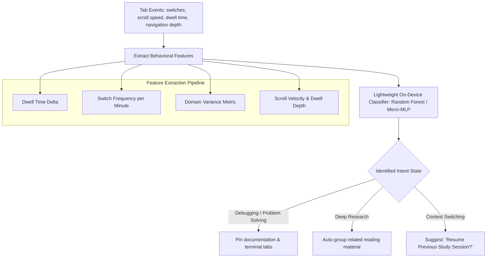

# Issue 024: [AI-FEAT] Real-Time User Intent Recognition and Predictive Tab Flow Engine

**Labels**: `ai`, `machine-learning`, `behavioral-modeling`, `roadmap-v2`

---

## 1. Context & Problem Statement
Directly fulfills repository Issue [#1](https://github.com/Inkesk-Dozing/entab-D/issues/1):
> *"To add automation Of Users Intent reading for Tab switch; Tab data storage and manipulation improvement; Insert Machine logic to parse Tab data and Log it in for recommendations."*

Traditional tab managers treat tabs as static URL lists. In reality, a user operates under dynamic **cognitive workflow states**:
- *Problem Solving State* (rapid switching between IDE localhost, LeetCode, StackOverflow, language docs).
- *Exploratory Research State* (depth-first branching from Google Scholar to arXiv papers to PDFs).
- *Passive Reading / Consumption State* (linear scrolling through documentation or news).

Without intent recognition, the browser cannot anticipate what the user wants to do next.

---

## 2. Technical Architecture & Behavioral Signal Processing

---

## 3. Implementation Plan
- [ ] Implement `src/behavior/intent_tracker.js`:
  - Calculate real-time rolling metrics over the last 15 minutes:
    - Tab switch velocity ($V_s = \Delta \text{switches} / \Delta t$).
    - Cross-domain transition entropy ($H$).
    - Average dwell duration per tab.
- [ ] Train a lightweight ONNX micro-classifier (`intent_classifier.onnx`, < 150KB) classifying user intent into 4 primary operational profiles:
  - `INTENT_DEBUGGING`
  - `INTENT_DEEP_RESEARCH`
  - `INTENT_CASUAL_READING`
  - `INTENT_COMMUNICATION`
- [ ] Connect intent state to UI:
  - Display current recognized intent badge in popup HUD.
  - Dynamically adapt tab recommendations based on active intent.

---

## 4. Acceptance Criteria
1. The engine accurately distinguishes between rapid debugging cycles and long-form document reading within 2 minutes of active browsing.
2. Inferred intent state updates dynamically with zero perceived CPU load (< 0.2% background CPU consumption).
3. Tab switch recommendations adapt to the recognized intent state, prioritizing documentation during debugging and articles during deep research.
