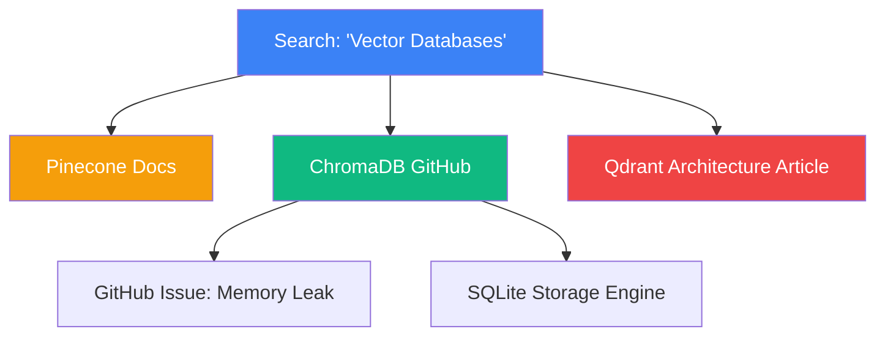

# Issue 025: [AI-FEAT] Interactive Tab Knowledge Graph & Spatial Relationship Mapping

**Labels**: `ai`, `visualization`, `ui/ux`, `roadmap-v2`

---

## 1. Context & Problem Statement
Chrome presents open tabs as a flat 1-dimensional horizontal strip. When tabs exceed 25, titles truncate to indistinguishable favicons.
In real-world knowledge work, tabs form a **multi-dimensional knowledge tree** or **directed web graph**:
- User searches on Google (Node 0).
- Opens 3 documentation tabs from results (Child Nodes 1, 2, 3).
- Follows internal links from Doc 1 to GitHub issues (Grandchild Nodes 4, 5).

Flattening this graph destroys the user's mental model. Users need a visual, spatial canvas displaying how tabs relate to each other chronologically, structurally, and semantically.

---

## 2. Technical Architecture & Force-Directed Graph Layout

Render an interactive 2D node-link diagram in a dedicated extension tab (`src/graph/graph.html`) using HTML5 Canvas / D3-force / WebGL:



### Graph Node Data Model
```typescript
interface TabGraphNode {
  id: number;           // Tab ID
  url: string;
  title: string;
  favIconUrl: string;
  groupId: number;
  openerTabId?: number; // Parent node (originating tab)
  clusterId: number;    // Semantic topic cluster
  dwellTime: number;    // Node visual radius proportional to attention
}
```

---

## 3. Implementation Plan
- [ ] Track tab parent-child lineage in `service_worker.js`:
  - Listen for `chrome.tabs.onCreated` and capture `tab.openerTabId`.
  - Record directed edges $(A \rightarrow B)$ representing tab spawn relationships.
- [ ] Compute semantic link edges:
  - If Tab X and Tab Y share high cosine similarity (> 0.75) via the embedding model (Issue 022), draw a dashed semantic link.
- [ ] Build spatial canvas in `src/graph/graph.html`:
  - Force-directed layout clustering related tabs physically together.
  - Clicking any node focuses that tab in Chrome.
  - Dragging a selection box over multiple nodes offers: *"Group these into a new Tab Group"*.

---

## 4. Acceptance Criteria
1. Opening the Tab Graph view displays all open tabs as an interactive, draggable network diagram.
2. Parent-child relationships (e.g. links opened in new tabs) are connected by directional arrows.
3. Node sizing visually reflects time spent on each tab.
4. Clicking any graph node smoothly focuses that tab in its active window.
