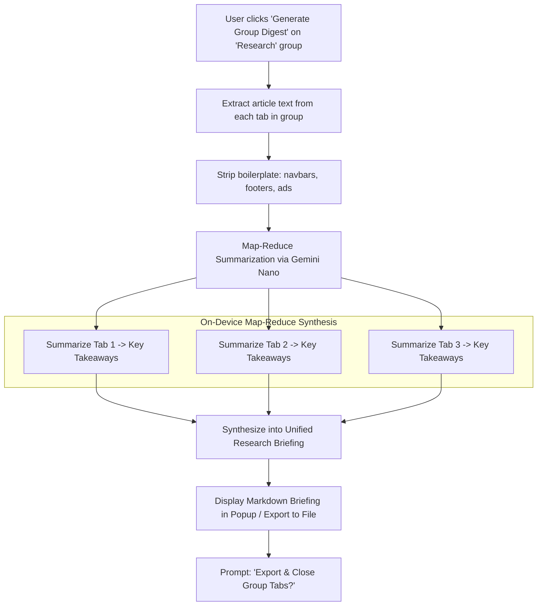

# Issue 026: [AI-FEAT] Generative Tab Group Digest and Multi-Tab Research Synthesizer

**Labels**: `ai`, `chrome-built-in-ai`, `productivity`, `roadmap-v2`

---

## 1. Context & Problem Statement
When conducting deep research across 15+ articles or documentation pages, users often struggle to consolidate their findings into actionable notes.
Tabs remain open for weeks simply because the user hasn't had time to summarize the key takeaways.

Using Chrome's on-device AI (`ai.summarizer` / Gemini Nano), Entab-D can synthesize all tabs in a group into a **single coherent Markdown research briefing**, allowing users to save the summary and close the tabs with peace of mind.

---

## 2. Technical Architecture & Multi-Doc Synthesis Pipeline

---

## 3. Implementation Plan
- [ ] Implement reader-mode text extractor using `Readability.js` injected via `chrome.scripting.executeScript`.
- [ ] Connect to `window.ai.summarizer` API (Chrome Built-in AI) with fallback to chunked prompts.
- [ ] Build interactive briefing modal:
  - Bullet-point synthesis of shared themes.
  - Source citations linking directly back to respective URLs.
  - One-click copy as Markdown or download as `.md` file.
  - Option to bookmark all tabs into a dedicated folder and close them automatically.

---

## 4. Acceptance Criteria
1. Synthesizes a 10-tab research group into a clean, well-formatted Markdown briefing in under 3 seconds.
2. Every major summary point cites its source tab title and URL.
3. Users can immediately download the briefing and close all group tabs with one click.
