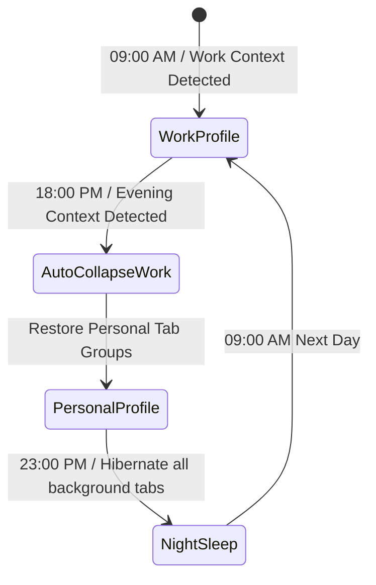

# Issue 027: [AI-FEAT] Context-Aware Workspace Auto-Switching and Time-of-Day Profiles

**Labels**: `ai`, `automation`, `productivity`, `roadmap-v2`

---

## 1. Context & Problem Statement
Users' browsing needs shift predictably across the day:
- **Work/Study Hours (09:00 - 18:00)**: Coding, documentation, email, spreadsheets.
- **Evening Leisure (18:00 - 23:00)**: Media, social, gaming, hobby projects.

Having all 60 tabs from work mixed with evening browsing creates clutter and distractions. The extension should learn user temporal schedules and context switches, offering intelligent profile switching (e.g. automatically collapsing or stashing "Work" tabs at 18:00 and surfacing "Study" or "Personal" tabs).

---

## 2. Technical Architecture & State Machine

---

## 3. Implementation Plan
- [ ] Implement `WorkspaceProfileManager`:
  - Profiles: `Work`, `Study`, `Personal`, `Deep Focus`.
  - Assign user rules to specific profiles (e.g., LeetCode and MDN to `Study`; Jira and GitHub to `Work`).
- [ ] Implement time-of-day scheduler (`chrome.alarms` API):
  - Automatically collapse groups belonging to inactive profiles.
  - Optional "Stash" mode: saves inactive tabs to Chrome Session Storage and closes them, restoring them when the profile reactivates.
- [ ] Add smart notification: *"It looks like you're wrapping up your workday. Switch to Personal profile?"*.

---

## 4. Acceptance Criteria
1. Switching profiles collapses/restores matching tab groups smoothly.
2. Inactive profile tabs can be stashed and closed to preserve CPU/RAM.
3. Users can set automatic time-of-day schedules or manual hotkeys to trigger profile switches.
