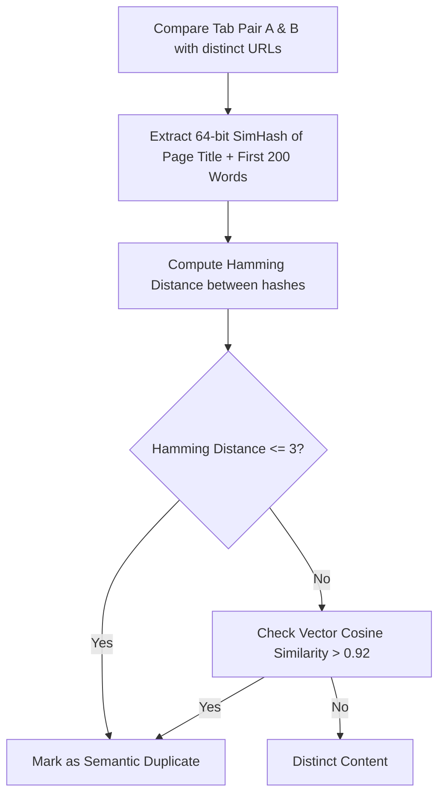

# Issue 028: [AI-FEAT] Semantic Duplicate Detection (Cross-URL Content Equivalence)

**Labels**: `ai`, `deduplication`, `nlp`, `roadmap-v2`

---

## 1. Context & Problem Statement
MVP 1's duplicate detector matches identical normalized URLs (e.g. `google.com/?q=a` vs `google.com/?q=a&utm=x`).
However, modern web browsing frequently spawns **semantic duplicates** where the URLs differ completely, but the actual content is 100% redundant:
- Syndicated news articles republished on multiple news portals.
- Mirrored documentation (e.g. `react.dev/reference/useState` vs `legacy.reactjs.org/docs/hooks-state`).
- Redundant search results tabs targeting the same query across Google, Bing, and DuckDuckGo.
- Mobile vs Desktop URL mirrors (`en.m.wikipedia.org` vs `en.wikipedia.org`).

---

## 2. Technical Architecture & SimHash Pipeline

---

## 3. Implementation Plan
- [ ] Implement lightweight 64-bit `SimHash` algorithm in JavaScript (< 100 lines of code, runs in microseconds).
- [ ] In `findDuplicates()`, add a second pass:
  - If URLs differ, compare SimHash of page text.
  - Flag matches as *"Semantic Duplicates (Different URLs, identical content)"*.
- [ ] Surface in Popup HUD with comparison diff:
  - Show side-by-side titles and domains.
  - Let user choose which version to retain (e.g., preferred domain).

---

## 4. Acceptance Criteria
1. Detects identical articles open across different URLs (e.g., Medium syndications or Wikipedia mobile/desktop mirrors).
2. Never flags distinct pages on the same domain as false positive duplicates.
3. User is shown a preview of both tabs before closing either.
