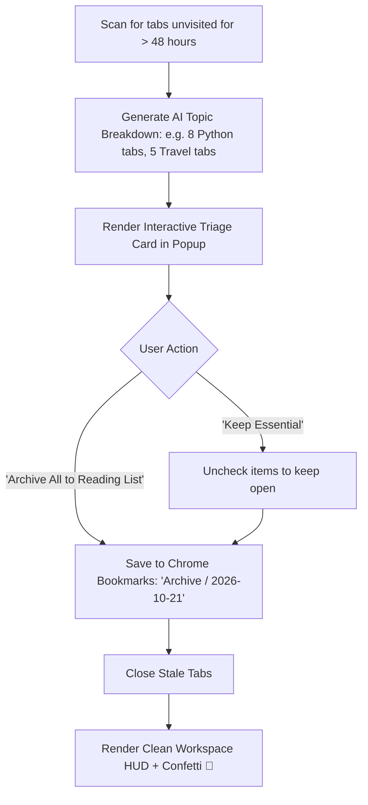

# Issue 029: [AI-FEAT] Intelligent Tab Triage & "Inbox Zero" Workspace Archival Assistant

**Labels**: `ai`, `productivity`, `ux`, `roadmap-v2`

---

## 1. Context & Problem Statement
Browser tab hoarding is fundamentally a psychological friction problem: users keep tabs open out of fear of losing context ("FOMO on articles/links"), eventually accumulating 100+ stale tabs that crash the browser.

An AI Tab Triage Assistant acts like an email "Inbox Zero" cleaner: it detects stale, neglected tabs, automatically clusters them into a structured archive, and lets the user clear their workspace with a single click.

---

## 2. Technical Architecture & Triage State Machine

---

## 3. Implementation Plan
- [ ] Implement stale tab detector based on `tab.lastAccessed` timestamp:
  - Default threshold: unvisited for > 48 hours.
- [ ] Group stale tabs by topic using the on-device classifier (Issue 021).
- [ ] Build "Tab Triage Assistant" drawer in `popup.html`:
  - *"You have 24 tabs untouched for 2+ days. Save to Bookmarks & Declutter?"*
  - Shows categorized breakdown with checkboxes.
  - One-click "Archive & Declutter".
- [ ] Export structured bookmark folders automatically named `Entab-D Archive - YYYY-MM-DD`.

---

## 4. Acceptance Criteria
1. Accurately identifies stale tabs unvisited for more than 48 hours.
2. Saving to bookmarks creates organized, timestamped bookmark trees.
3. Successfully closing 30+ stale tabs restores browser performance and displays celebratory "Inbox Zero" UI.
