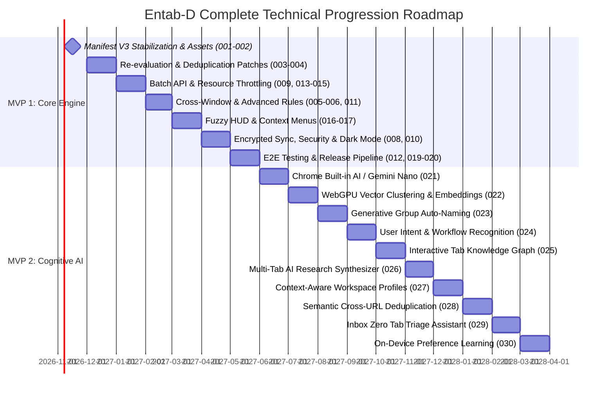

# Entab-D Development Roadmap

This document outlines the strategic milestones and technical progression for Entab-D across successive release phases, divided into **MVP 1 (Core Hardened Engine)** and **MVP 2 (Cognitive AI Workspace Layer)**.

---

## Part I: MVP 1 — Hardened Deterministic Foundation (Issues 001–020)

### Phase 1: Architectural Stabilization & Manifest V3 Alignment
- [Issue 001: Manifest Module Resolution & Missing Assets](issues/001-fix-manifest-module-resolution-and-missing-assets.md)
- [Issue 002: Service Worker Lifecycle & State Persistence](issues/002-fix-service-worker-lifecycle-and-state-persistence.md)

### Phase 2: Core Engine Bug Resolution & Resource Optimization
- [Issue 003: Dynamic Tab Re-evaluation on Rule Updates](issues/003-fix-dynamic-tab-reevaluation-on-rule-updates.md)
- [Issue 004: Race Condition in Duplicate Tab Removal](issues/004-fix-race-condition-in-duplicate-detection-and-removal.md)
- [Issue 009: Batch Tab Operations & API Throttling](issues/009-perf-batch-tab-query-and-tabgroups-api-throttling.md)
- [Issue 013: Tab Discarding & Memory Saver Integration](issues/013-perf-chrome-tab-discarding-and-memory-saver-integration.md)
- [Issue 014: Pinned & Audible Tab Exclusion Policies](issues/014-feat-pinned-tab-and-audible-tab-exclusion-policies.md)
- [Issue 015: Storage Quota Guard & Sync Chunking](issues/015-perf-storage-quota-guard-and-sync-chunking.md)

### Phase 3: Advanced Tab Management & Ergonomics
- [Issue 005: Cross-Window Tab Group Consolidation](issues/005-feat-cross-window-tab-group-consolidation.md)
- [Issue 006: Rule Conflict Detection & Priority Ordering](issues/006-feat-rule-conflict-detection-and-priority-resolution.md)
- [Issue 011: Advanced Subdomain Wildcards & Path Matching](issues/011-feat-domain-hierarchy-and-subdomain-wildcard-matching.md)
- [Issue 017: Context Menus for Quick Rule Creation](issues/017-ui-context-menu-actions-for-quick-rule-creation.md)

### Phase 4: Basic Predictive Navigation & Keyboard Access
- [Issue 007: Bounded Markov Predictive Tab Switching](issues/007-feat-markov-chain-predictive-tab-switching.md)
- [Issue 016: Keyboard-Driven Fuzzy Tab Switcher HUD](issues/016-feat-keyboard-driven-fuzzy-tab-switcher-hud.md)

### Phase 5: Security Hardening & Encrypted Storage
- [Issue 008: Local Sync Daemon Security & CORS Mitigation](issues/008-sec-secure-local-sync-daemon-and-cors-mitigation.md)
- [Issue 018: Encrypted Backup Export & Import](issues/018-sec-end-to-end-encrypted-backup-export-and-import.md)

### Phase 6: UI/UX Modernization & Release Tooling
- [Issue 010: Dark Mode & Accessible Tab Interface](issues/010-ui-dark-mode-and-accessible-tab-management-interface.md)
- [Issue 012: Automated Playwright E2E Test Suite](issues/012-test-end-to-end-playwright-extension-test-suite.md)
- [Issue 019: Tab Productivity Visualizer & Analytics](issues/019-ui-tab-analytics-dashboard-and-productivity-visualizer.md)
- [Issue 020: Automated Chrome Web Store Packaging Pipeline](issues/020-chore-automated-chrome-web-store-packaging-and-release-pipeline.md)

---

## Part II: MVP 2 — Cognitive AI Workspace Layer (Issues 021–030)

### Phase 7: On-Device AI Classification & Vector Clustering
- [Issue 021: On-Device Tab Classification via Chrome Built-in AI (Prompt API / Gemini Nano)](issues/021-feat-chrome-built-in-ai-prompt-api-integration.md)
  *Zero-shot tab categorization using local NPU/GPU without external cloud dependencies.*
- [Issue 022: WebGPU Local Embeddings & Semantic Unsupervised Tab Clustering](issues/022-feat-local-embeddings-and-semantic-tab-clustering.md)
  *Dense vector similarity grouping via Transformers.js in an offscreen document.*
- [Issue 023: Generative Group Labeling & Contextual Title Auto-Generation](issues/023-feat-smart-auto-naming-of-unlabeled-tab-groups.md)
  *Automatic 2-to-3 word contextual group title synthesis from tab contents.*

### Phase 8: Intent Modeling & Spatial Knowledge Graph
- [Issue 024: Real-Time User Intent Recognition and Predictive Tab Flow Engine](issues/024-feat-user-intent-and-workflow-state-recognition.md)
  *Implements Issue #1: cognitive behavioral state recognition (Debugging vs Research vs Reading).*
- [Issue 025: Interactive Tab Knowledge Graph & Spatial Relationship Mapping](issues/025-feat-semantic-tab-graph-and-spatial-workspace-mapping.md)
  *Force-directed 2D interactive canvas mapping parent-child tab relationships and semantic clusters.*

### Phase 9: Generative Synthesis & Semantic Deduplication
- [Issue 026: Generative Tab Group Digest and Multi-Tab Research Synthesizer](issues/026-feat-ai-smart-tab-summarizer-and-digest-generator.md)
  *Map-reduce summarization consolidating 10+ tabs into a unified Markdown research briefing.*
- [Issue 028: Semantic Duplicate Detection (Cross-URL Content Equivalence)](issues/028-feat-duplicate-tab-semantic-equivalence-detection.md)
  *SimHash and vector similarity detecting redundant articles open across different domains.*

### Phase 10: Adaptive Workspaces & Autonomous Triage
- [Issue 027: Context-Aware Workspace Auto-Switching and Time-of-Day Profiles](issues/027-feat-context-aware-workspace-auto-switching.md)
  *Automatic profile switching between Work, Study, and Personal browsing modes.*
- [Issue 029: Intelligent Tab Triage & "Inbox Zero" Workspace Archival Assistant](issues/029-feat-smart-tab-triage-and-inbox-zero-auto-archive.md)
  *Stale tab detection, automated topic archiving, and single-click decluttering.*
- [Issue 030: Local On-Device Preference Refinement & Federated Learning Guard](issues/030-feat-privacy-preserving-federated-model-fine-tuning.md)
  *Continuous on-device weight adaptation learning from manual user corrections.*
